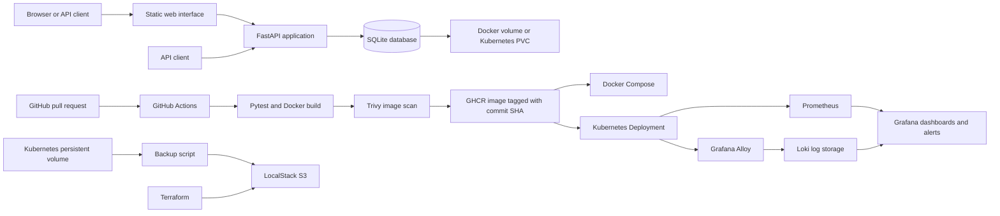

# LogiFlow WMS

LogiFlow WMS is a portfolio project for warehouse operations and hands-on DevOps practice. The FastAPI service tracks products, inventory by storage location, inbound and outbound movements, orders, packing plans, palletization, and truck loading.

The project is designed to run locally with Docker Compose or on a single-node Kubernetes cluster in Docker Desktop. GitHub Actions tests and scans the application image, then publishes multi-platform images to GitHub Container Registry (GHCR).

## What it does

- Validates products and stock requests with Pydantic and stores warehouse data in SQLite.
- Tracks stock by rack location, records inventory movements, receives goods, transfers stock, and confirms picks.
- Creates orders and plans box packing, palletization, and truck loading.
- Serves a browser interface at `/` and interactive API documentation at `/docs`.
- Exposes `/health` and `/ready` endpoints for container and Kubernetes health checks.

## Architecture



## Technology

| Area | Tools |
| --- | --- |
| API and validation | Python, FastAPI, Pydantic |
| Database | SQLite |
| Web interface | HTML, CSS, JavaScript |
| Tests | pytest |
| Containers | Docker, Docker Compose |
| CI and image registry | GitHub Actions, Trivy, GHCR, Docker Buildx, QEMU |
| Local orchestration | Kubernetes in Docker Desktop, Helm |
| Metrics and alerts | Prometheus, Grafana, metrics-server |
| Logs | Grafana Alloy, Loki |
| Backup and infrastructure as code | LocalStack S3, AWS CLI, Terraform |

## Run with Docker Compose

Requirements: Docker Desktop with Docker Compose. Compose is pinned to the currently selected GHCR commit image; update its tag when promoting another image version.

```bash
docker compose pull
docker compose up -d
docker compose ps
```

Open <http://127.0.0.1:8000/> for the interface and <http://127.0.0.1:8000/docs> for the API documentation.

```bash
curl http://127.0.0.1:8000/health
curl http://127.0.0.1:8000/ready
docker compose logs --tail 50 api
```

`/health` reports that the API process responds. `/ready` also checks the SQLite database. Compose marks the service healthy when its readiness check succeeds. SQLite is stored in the named volume `logiflow-data`, so recreating the container keeps the database.

Stop the service with `docker compose down`. The named volume is retained unless it is explicitly removed.

## Run on local Kubernetes

Requirements: Docker Desktop Kubernetes enabled, `kubectl`, and access to the public GHCR image.

```bash
kubectl apply -f k8s/storage.yaml
kubectl apply -f k8s/deployment.yaml
kubectl apply -f k8s/service.yaml
kubectl rollout status deployment/logiflow-wms
```

The Deployment runs one API pod. The Service provides a stable in-cluster address, and the PersistentVolumeClaim mounts the SQLite database at `/data`.

Forward the Service to local port 8001 (port 8000 is used by Compose in this example):

```bash
kubectl port-forward service/logiflow-wms 8001:8000
```

In another terminal, check the application:

```bash
curl http://127.0.0.1:8001/health
curl http://127.0.0.1:8001/ready
kubectl get deployment,pods,service,pvc
```

### Promote an image version

CI publishes an image tagged with the full Git commit SHA and also updates `latest`. Kubernetes and Compose use a fixed SHA tag so the deployed image is reproducible. After a new image is published:

1. Change the image tag in `k8s/deployment.yaml` and `compose.yaml` to the full SHA reported by the successful `Publish image to GHCR` job.
2. Review and commit the manifest change through a pull request.
3. Apply the Kubernetes manifest and wait for rollout:

```bash
kubectl apply -f k8s/deployment.yaml
kubectl rollout status deployment/logiflow-wms
```

To roll back the running Deployment, use `kubectl rollout undo deployment/logiflow-wms`. Then update `k8s/deployment.yaml` to the desired SHA and apply it so the manifest and cluster state agree.

## Monitoring and logs

The local cluster uses metrics-server for `kubectl top`, Prometheus for metrics, Grafana for dashboards and alerting, and Loki with Alloy for pod logs.

```bash
kubectl top pods -l app=logiflow-wms
kubectl logs -l app=logiflow-wms --tail=50
kubectl port-forward -n monitoring deployment/monitoring-grafana 3000:3000
```

Open <http://127.0.0.1:3000>. Grafana assets are stored in [`k8s/monitoring/grafana/`](k8s/monitoring/grafana/): the dashboard JSON, alert rule provisioning YAML, ConfigMap, and Helm mount values. File-provisioned rules are changed in Git and loaded by Grafana; they are not edited directly in the UI. The `logiflow-email` contact point still needs to be created in Grafana after a fresh install; the rule file references it but does not define it yet.

Loki and Alloy Helm values are tracked in `k8s/monitoring/`. SMTP server settings are in the local, Git-ignored `k8s/monitoring/grafana-smtp-values.yaml`; recreate that file locally when configuring email notifications. Never commit SMTP credentials.

## Backup and LocalStack S3

`scripts/backup-to-localstack.sh` takes a consistent SQLite snapshot from the Kubernetes pod, copies it to the Mac, runs `PRAGMA integrity_check`, and uploads it to the local S3-compatible bucket. Start Docker Desktop, the Kubernetes cluster, and LocalStack with persistence before running the script.

Terraform configuration for the bucket is in `terraform/localstack/main.tf`. Terraform state and the `.terraform/` provider download directory are local and ignored by Git; `.terraform.lock.hcl` is checked in to record provider selections. LocalStack emulates AWS S3 on the developer machine; this project has not deployed its infrastructure to a real AWS account.

## CI pipeline

For pull requests targeting `main`, GitHub Actions:

1. Installs the development dependencies and runs pytest.
2. Builds the Docker image.
3. Scans the image with Trivy and fails on fixable high or critical vulnerabilities.

After a push to `main`, a dependent job uses QEMU and Buildx to publish `linux/amd64` and `linux/arm64` images to GHCR. One tag contains the full commit SHA; `latest` is also updated. The workflow publishes images but does not deploy to the developer's local Kubernetes cluster.

## Repository map

| Path | Contents |
| --- | --- |
| `app/` | FastAPI routes, SQLite access, warehouse planning logic, and static UI |
| `tests/` | API and business-logic tests |
| `Dockerfile`, `compose.yaml` | Container image and local Compose service |
| `.github/workflows/ci.yml` | Tests, image build, Trivy scan, and GHCR publication |
| `k8s/` | Kubernetes app, storage, metrics, logging, and Grafana configuration |
| `scripts/backup-to-localstack.sh` | Kubernetes SQLite backup and S3 upload |
| `terraform/localstack/` | Terraform-managed local S3 bucket |
| `docs/learning-recap.ro.md` | Romanian project and DevOps concepts recap |

## Development

Create and activate a virtual environment, then install dependencies and run the tests:

```bash
python3 -m venv .venv
source .venv/bin/activate
python -m pip install -r requirements-dev.txt
python -m pytest -q
```

The normal Git workflow is: create a feature branch, make a focused change, run the relevant checks, open a pull request to `main`, review the Actions checks, merge, and pull the updated `main` branch locally.

## Scope and limitations

- This is a learning and portfolio project, not a production WMS deployment.
- The Kubernetes cluster is local and single-node; its hostpath storage is not a cloud-grade storage service.
- The API uses SQLite and is intentionally kept at one pod replica. Multi-replica writes require a database designed for concurrent clients.
- LocalStack provides a local AWS-compatible S3 emulator; it is not a real AWS deployment.
